<picture>
  <source media="(prefers-color-scheme: dark)" srcset="assets/board-dark.svg">
  
</picture>

Local-first open-source software across Rust, Python, C#, PowerShell, TypeScript, and Go: desktop utilities, Windows networking clients, Kali Linux workflows, and offline browser apps with zero accounts, zero tracking, and plain inputs and outputs. The interactive catalog lives at **[real-fruit-snacks.github.io](https://real-fruit-snacks.github.io/)** (front door: **[rfs.tools](https://rfs.tools/)**).

| Tool | What it does |
|---|---|
| [**screen-mark**](https://github.com/Real-Fruit-Snacks/screen-mark) Rust · Windows, Linux | Screenshot capture and annotation in pure Rust |
| [**port-sync**](https://github.com/Real-Fruit-Snacks/port-sync) Rust · Windows | Keeps qBittorrent's port synced to Proton VPN |
| [**carify**](https://github.com/Real-Fruit-Snacks/carify) sh, PowerShell · Windows, macOS, Linux | Convert video for Uconnect USB playback, via ffmpeg |
| [**certapi**](https://github.com/Real-Fruit-Snacks/certapi) C# · Windows | mTLS API client for the Windows certificate store |
| [**identity-gen**](https://github.com/Real-Fruit-Snacks/identity-gen) HTML · Browser | Offline generator for throwaway signup identities |
| [**amazon-order-sync**](https://github.com/Real-Fruit-Snacks/amazon-order-sync) Rust · Windows, Linux | Syncs your Amazon orders into local Markdown notes |
| [**powershell-toolbox**](https://github.com/Real-Fruit-Snacks/powershell-toolbox) PowerShell · Windows | A grab-bag of my PowerShell scripts, each one standalone |
| [**pwn-broker**](https://github.com/Real-Fruit-Snacks/pwn-broker) Python · Kali Linux | Keeps a box's targets, notes, creds, and tools in order |
| [**pwn-shop**](https://github.com/Real-Fruit-Snacks/pwn-shop) Python · Kali Linux | Tool packages for pwn-broker, built from upstream releases |
| [**pwn-playbooks**](https://github.com/Real-Fruit-Snacks/pwn-playbooks) Markdown · Kali Linux | Playbooks for pwn-broker: read into the note, fill in, run |
| [**pwn-report**](https://github.com/Real-Fruit-Snacks/pwn-report) Python · Kali Linux | Private, evidence-linked reports from pwn-broker archives |
| [**open-file**](https://github.com/Real-Fruit-Snacks/open-file) TypeScript · Browser | Learn and play chess in your browser, offline |
| [**one-billion-pixels**](https://github.com/Real-Fruit-Snacks/one-billion-pixels) TypeScript · Browser | Excavate one billion pixels in your browser, offline |
| [**hash-bait**](https://github.com/Real-Fruit-Snacks/hash-bait) Rust · Windows, Linux | Drop poisoned shortcuts on SMB shares to coerce NTLM hashes |
| [**cred-spray**](https://github.com/Real-Fruit-Snacks/cred-spray) Python · Windows, Linux | Bounded, protocol-aware credential spraying |
| [**ad-sweep**](https://github.com/Real-Fruit-Snacks/ad-sweep) Rust · Windows, Linux | Runs isolated Active Directory enumeration with NetExec |
| [**shell-tunnel**](https://github.com/Real-Fruit-Snacks/shell-tunnel) Go · Windows, Linux | Static SSH server for bind and reverse shells, PTY and SFTP |

Supporting repositories: [rfs-brand](https://github.com/Real-Fruit-Snacks/rfs-brand) (Cyclorama Dawn brand system, marks, and repo cover tools), [rfs-themes](https://github.com/Real-Fruit-Snacks/rfs-themes) (Cyclorama Dawn themes and ports for everyday apps), and [rfs.tools](https://rfs.tools/) (the single-page front door).

### Core principles

- **Local-first by default:** Software runs on your machine against your own files, certs, and processes—not behind a cloud service.
- **No accounts or tracking:** Zero signups, zero telemetry beacons, and zero third-party analytics.
- **Source-first on GitHub:** Every active project is public, inspectable, and documented plainly beside its real inputs and outputs.
- **Direct downloads & reproducible setups:** Releases, source builds, and scripted setups stay straightforward without vendor lock-in.

Issues and pull requests are welcome on any active repository. If one of these tools saves you time, you can [sponsor me](https://github.com/sponsors/Real-Fruit-Snacks).

The board above is generated by [`art/make-board.py`](art/make-board.py) in Big Shoulders Stencil, Albert Sans, and Azeret Mono.
